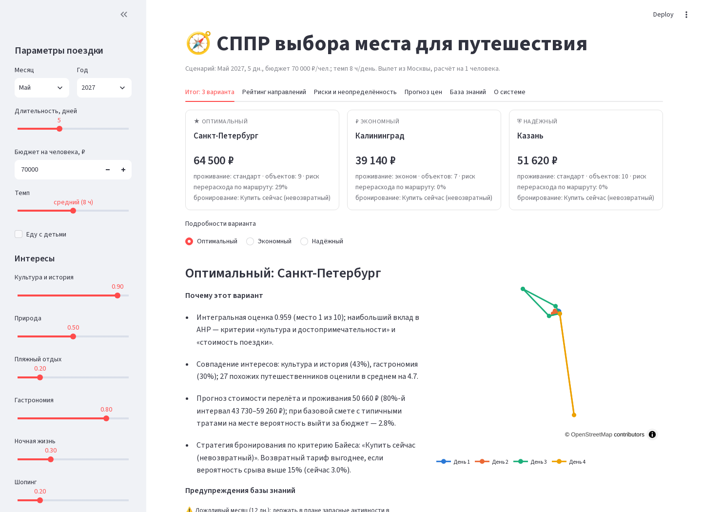

# СППР выбора места для путешествия

Система поддержки принятия решений, которая помогает туристу выбрать направление и составить маршрут
с учётом интересов, бюджета, ограниченного времени и неопределённости цен, погоды и срыва поездки.

На выходе ЛПР получает три обоснованных варианта: **«Оптимальный»**, **«Экономный»** и **«Надёжный»**,
каждый с маршрутом по дням, сметой, стратегией бронирования, рисками и предупреждениями.

**Демонстрация:** _ссылка на запись или развёрнутое приложение_



## Быстрый старт

```bash
python -m venv .venv && source .venv/bin/activate        # Windows: .venv\Scripts\activate
pip install -r requirements.txt
python run_all.py                     # все 8 практик, результаты в reports/, kb/, superset/data/
streamlit run app/streamlit_app.py    # прототип СППР: http://localhost:8501
python -m pytest -q                   # 17 проверок свойств модулей
```

Для логического вывода ризонером Pellet нужна Java 11–21 (`java -version`). Без Java модуль базы знаний
переключается на эквивалентный вывод на Python, результаты совпадают.

**BI-дашборд (Apache Superset):**

```bash
cd superset
docker compose up        # первый запуск 2–3 мин; затем http://localhost:8088, логин admin / admin
```

Дашборд «СППР: выбор места для путешествия» импортируется автоматически из `superset/dashboard_export.zip`
и читает витрины из `superset/data/tdss.db`. Если Superset уже установлен: «Дашборды → Импорт» и укажите
архив, а в подключении базы данных задайте путь к файлу `tdss.db` на своей машине. Учётная запись
admin / admin и ключ по умолчанию предназначены только для локального запуска.

## Как формируются варианты

1. Прогноз цен (П6) даёт ожидаемую стоимость и её разброс на месяц поездки.
2. База знаний (П5) отсеивает недопустимые направления (бюджет, виза, жара при поездке с детьми и т. д.)
   и объясняет причину.
3. АНР (П2) оценивает допустимые направления по 6 критериям. Веса задаёт ЛПР: матрицей парных сравнений,
   оценками 1–9 или автоматически по профилю интересов.
4. Рекомендательный модуль (П7) оценивает соответствие интересам; интегральная оценка
   F = 0,7 · АНР + 0,3 · рекомендации (обе нормированы на максимум).
5. Дерево решений и Монте-Карло (П3) выбирают стратегию бронирования и оценивают риск перерасхода.
6. MILP-модель (П4) строит маршрут по дням и выбирает класс проживания.

| Вариант | Направление | Стратегия бронирования | Маршрут |
|---|---|---|---|
| Оптимальный | максимум F | критерий Байеса | резерв 5 % бюджета |
| Экономный | самое дешёвое среди F ≥ 0,85 · max F | критерий Байеса | только эконом-проживание |
| Надёжный | максимум критерия Гурвица (α = 0,6) среди оставшихся | критерий Гурвица | резерв 15 % бюджета |

## Структура

| Практика паспорта | Модуль | Скрипт | Основной результат |
|---|---|---|---|
| 1. Постановка задачи | `tdss/data.py` | `practices/p1_problem.py` | `reports/p1_problem.json` |
| 2. Многокритериальный анализ (АНР) | `tdss/ahp.py` | `practices/p2_ahp.py` | веса, ОС, оценки, чувствительность |
| 3. Риски и неопределённость | `tdss/uncertainty.py` | `practices/p3_uncertainty.py` | дерево решений, критерии, пороги, Монте-Карло |
| 4. Оптимизационная модель | `tdss/route_opt.py` | `practices/p4_route.py` | MILP-маршрут по дням (PuLP) |
| 5. База знаний | `tdss/knowledge.py` | `practices/p5_knowledge.py` | `kb/travel_dss.owl` (Protégé), правила, вывод |
| 6. Предиктивная аналитика и BI | `tdss/forecast.py`, `tdss/bi_export.py` | `practices/p6_forecast.py` | прогноз цен, метрики, дашборд Superset |
| 7. Рекомендательный модуль | `tdss/recommender.py` | `practices/p7_recommender.py` | гибридные рекомендации с объяснениями |
| 8. Итоговая СППР | `tdss/pipeline.py`, `app/streamlit_app.py` | `practices/p8_dss.py` | прототип, 4 сценария ЛПР |

```
data/          исходные данные (направления, климат, 100 объектов, история цен, пользователи и оценки)
scripts/       generate_data.py - генерация синтетических рядов и оценок (seed = 42)
tdss/          ядро СППР
practices/     скрипты практик паспорта
app/           интерфейс ЛПР (Streamlit)
kb/            онтология OWL и выведенные факты
superset/      docker-compose, конфигурация, архив дашборда, витрины tdss.db, скрипт сборки дашборда
reports/       результаты практик: CSV, JSON, PNG
docs/          скриншоты и сценарий демонстрации (docs/demo_script.md)
tests/         проверки свойств модулей
```

## Данные и допущения

* Базовые цены, время перелёта, индекс безопасности и профили направлений - экспертные оценки
  на 2026 г.; климат - усреднённые многолетние нормы.
* История цен (2019–2026) и оценки 600 пользователей - **синтетические** (`scripts/generate_data.py`):
  тренд инфляции, курс валюты, сезонность, ковидный провал 2020 г., шок марта 2022 г., AR(1)-шум.
  Оценки порождены из тех же профилей интересов, что использует контентная модель, поэтому метрики
  рекомендателя (NDCG@3 ≈ 0,97) завышены относительно реальных отзывов.
* Расчёт ведётся на 1 человека с вылетом из Москвы; дата планирования 12.10.2026.

## Ограничения

* 10 направлений и 100 объектов; время в пути - по прямой с коэффициентом извилистости,
  без расписаний транспорта и часов работы объектов.
* Вероятности срыва поездки для внутренних направлений малы (3 %), поэтому выбор направления
  почти не зависит от отношения ЛПР к риску; от него зависит стратегия бронирования.
* Для удалённых направлений (Горный Алтай) за день помещается мало объектов: модель не умеет
  переезжать между отелями.
